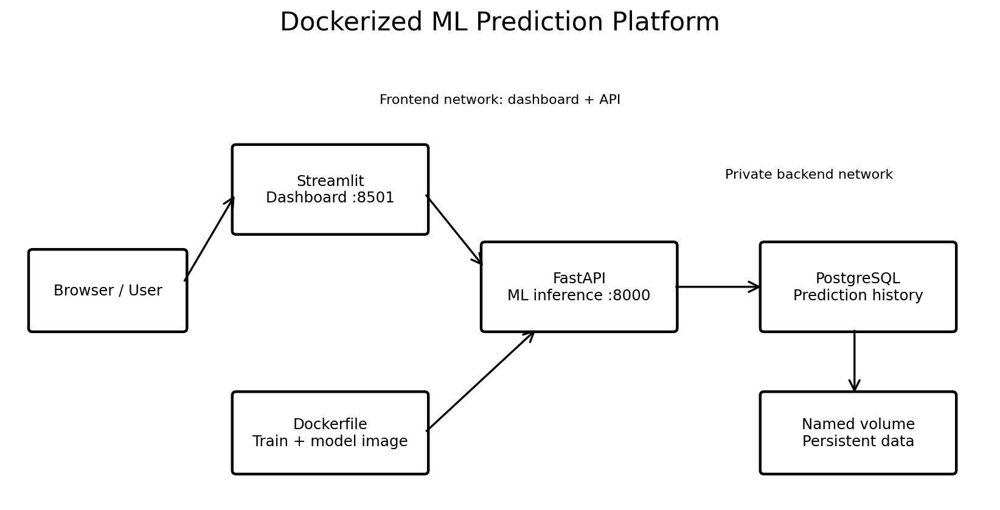

# Real-World Docker ML Project: Customer Churn Platform

A multi-container, educational ML serving platform featuring:

- **ML training:** reproducible synthetic customer dataset, scikit-learn preprocessing and logistic regression
- **FastAPI:** input validation, single-customer prediction, health and model metrics endpoints
- **PostgreSQL:** persistent prediction history
- **Streamlit:** web dashboard for predictions and history
- **Docker:** separate API and dashboard images, multi-stage API build, health checks, non-root processes, named volume, network isolation
- **CI:** pytest, Docker builds, GitHub Container Registry publishing on `main`

**Important:** This is an end-to-end realistic *engineering architecture*, not a production-grade churn model. Training data are **synthetic**, performance numbers are synthetic-data metrics, and the resulting scores must not be used for real customer decisions. The database stores submitted feature values and prediction results in plain text; do not send real personal information without access controls, retention policies, encryption, and proper governance.

## Architecture



## Requirements

Docker Engine / Docker Desktop with the Docker Compose plugin. Python 3.12 for local tests. All services run locally.

## Step 1: Configure

```bash
cp .env.example .env
```

Replace the example `POSTGRES_PASSWORD` with a strong password in `.env`. Never commit `.env` or bake API keys into an image.

## Step 2: Build and start

```bash
docker compose up --build -d
docker compose ps
docker compose logs -f api
```

The first build installs Python dependencies and trains the model inside the Docker build's `trainer` stage. Training artifacts are copied into the API image.

## Step 3: Explore

- Dashboard: http://localhost:8501
- API Swagger docs: http://localhost:8000/docs
- Health: http://localhost:8000/health
- Model info: http://localhost:8000/model/info

```bash
curl -X POST http://localhost:8000/predict \
  -H "Content-Type: application/json" \
  -d '{"tenure_months":12,"monthly_spend":80,"support_tickets":3,"contract_type":"monthly","auto_pay":"no"}'

curl http://localhost:8000/predictions
```

Or run `bash scripts/smoke_test.sh` in Git Bash / WSL / Linux / macOS.

## Step 4: Inspect Docker

```bash
docker compose images
docker compose ps
docker compose exec api sh
docker compose exec db psql -U mluser -d mldb -c 'SELECT id, churn_probability FROM predictions;'
docker compose logs dashboard
docker volume ls
docker network ls
```

Compose service name `db` is the hostname seen by the API. `localhost` *inside the API container* refers to the API container, not PostgreSQL. PostgreSQL is on the private backend network and has no host-published port.

## Step 5: Change and rebuild

Modify the formula or model in `ml/train.py`, then:

```bash
docker compose build --no-cache api
docker compose up -d api
```

Why `--no-cache` here? To force retraining for educational purposes. Normal Docker caching will rebuild when the copied training source changes, without this flag.

## Step 6: Local Python testing (outside Docker)

```bash
python -m venv .venv
source .venv/bin/activate  # PowerShell: .venv\Scripts\Activate.ps1
pip install -r requirements-dev.txt
pytest -q
python -m ml.train
```

The tests use a local temporary **SQLite database** for isolation, while Compose uses PostgreSQL. SQLite does not prove full PostgreSQL integration; add PostgreSQL integration tests for a production CI pipeline.

## Step 7: Shut down

```bash
docker compose down
```

Data persist in the `postgres_data` named volume. To delete **all database data**:

```bash
docker compose down -v
```

## Key files to read in order

| File | Purpose |
|---|---|
| `ml/train.py` | Generate synthetic training examples, fit model, evaluate, save artifacts |
| `ml/features.py` | Shared feature contract |
| `app/schemas.py` | Request validation and response contract |
| `app/main.py` | API endpoints and inference logic |
| `app/database.py` | SQLAlchemy ORM and persistence |
| `Dockerfile` | Two-stage ML build and non-root API runtime |
| `dashboard/Dockerfile` | Dashboard container image |
| `compose.yaml` | Entire multi-service application |
| `.env.example` | Local configuration template |
| `.dockerignore` | Excludes local secrets/files from build context |
| `tests/` | Training and API regression tests |
| `.github/workflows/ci.yml` | CI build, tests, GHCR push |
| `notebooks/learning_walkthrough.ipynb` | Guided exercises |

## Real production upgrades

1. Train on consented, representative, versioned real data; maintain a held-out evaluation set and check drift.
2. Use Alembic DB migrations rather than `create_all` at startup.
3. Add authentication, rate limiting, access controls, TLS, and audit/retention practices.
4. Pin and audit image and Python dependency versions with digests/lockfiles.
5. Add integration tests against PostgreSQL, observability, rolling deploy, and rollback strategy.
6. Keep registries private if exposing business-specific models.
7. Store sensitive secrets in your platform's secret manager. In this tutorial, `.env` is for **local development only**.

### CI publishing note

The workflow publishes an API image to **GitHub Container Registry** as `ghcr.io/OWNER/REPO:COMMIT_SHA` on main branch pushes, provided Actions permissions allow package publishing. It does **not** automatically deploy anywhere; CI and deployment are separate concerns.
